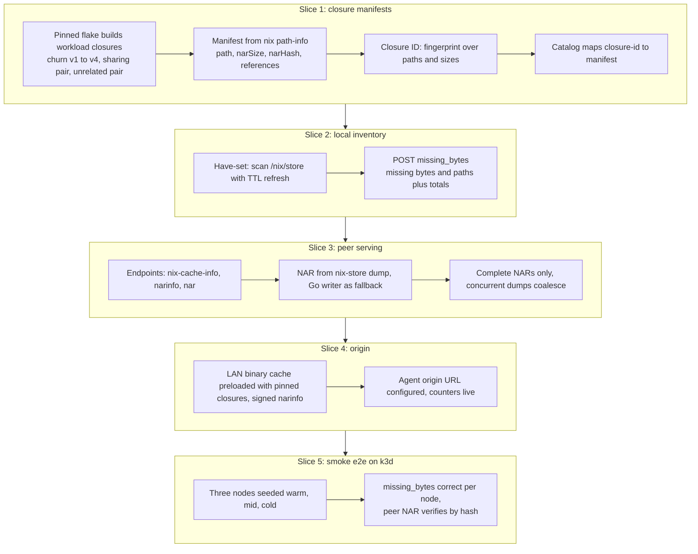
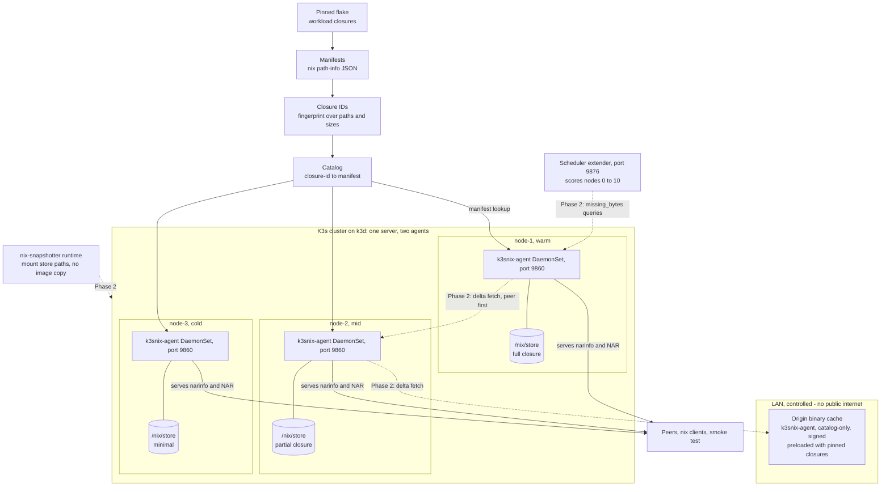

# Phase 1 Plan — Closure Analysis and Cache Inventory

Phase 1 covers the first two boxes of the architecture deck: (1) Nix closure
analysis with content-addressed paths and a pinned manifest, and (2) initializing
the cache inventory across the local, peer, and origin tiers. It delivers the
data plane only. Scheduling, the delta fetch, the runtime
and the benchmark arrive in Phase 2.

The operating rule for this phase: **serve and count, never fetch on a pod
start.**

## Goal

Any closure built from the pinned flake can be described by a manifest and a
content-derived ID, and every node in the cluster can answer two questions
through the agent: what am I missing from this closure, and here is the NAR for
a path I hold. The origin tier exists, is preloaded, and is counted, even though
nothing pulls from it until Phase 2.

## Scope

In scope:

- Pinned flake building the workload closures and emitting manifests
- Content-derived closure IDs and the catalog that maps them to manifests
- Node agent inventory (have-set) and the missing-bytes API
- Node agent serving the Nix binary-cache protocol for peers
- A controlled LAN origin binary cache, preloaded and instrumented
- A smoke e2e on a three-node k3d cluster

Out of scope (guard rails against creep):

- Scheduler extender, scoring, any kube-scheduler integration (Phase 2)
- Fetching missing NARs from peers or origin (Phase 2 delta fetch)
- nix-snapshotter, pod rootfs, lazy mounts (Phase 2)
- Benchmark numbers, crossover sweeps, traffic shaping (Phase 2 and the
  harness phases of spec.md)

## Acceptance criteria

- [x] `nix flake lock` pins nixpkgs and every workload input; versions are recorded
- [x] Each closure emits a manifest from `nix path-info --json`: path, narSize,
      narHash, references
- [x] Closure IDs are fingerprints over the path list plus sizes, never taken
      from a pod annotation
- [x] The catalog maps closure-id to manifest, and Go code parses both nix
      native JSON and the project format
- [x] The three workload families exist with measured deltas: the churn ladder
      v1 to v4 (1 to 5 percent byte steps, verified with `nix path-info -rS`),
      a glibc-sharing pair, and an unrelated pair as the negative control
- [x] The agent answers `POST /v1/missing_bytes(closure)` from its own
      `/nix/store` with missing bytes and paths plus totals; the have-set is
      TTL-refreshed and never leaves the node toward the API server
- [x] The agent serves `/nix-cache-info`, `*.narinfo`, and `nar/*.nar`; every
      served NAR hash-matches its narinfo; a partial NAR is never visible;
      concurrent same-path dumps coalesce
- [x] The LAN origin cache is running, preloaded with the pinned closures, and
      the agent's origin request and byte counters increment (no dead flags)
- [x] Smoke e2e passes: three k3d nodes seeded warm, mid, and cold; each node's
      missing-bytes answer is correct for its state, and a NAR fetched from a
      peer verifies byte-identical by hash
- [x] `nix flake check` stays green throughout

## Status and results

Phase 1 is complete: every criterion above passes. Reproduce with:

```sh
go test ./... && nix flake check   # unit and integration tests, manifests
hack/e2e-k3d.sh                    # three-node k3d smoke
hack/demo-real-closures.sh         # the numbers below, on the real closures
```

Measured on the pinned closures (`nix build .#closures`, `summary.json`).
"Closure delta" compares closure sizes, which is what the 1 to 5 percent
ladder constrains; "transfer" is what a node on the previous version
actually fetches, which is slightly larger because the root path changes on
every version too. The agent's `missing_bytes` reports the transfer figure.

| Step | Closure delta | Transfer |
|---|---|---|
| churn-v1 to v2 | 205,360 B (2.45%) | 206,248 B (2.40% of v2) |
| churn-v2 to v3 | 279,088 B (3.25%) | 280,248 B (3.16% of v3) |
| churn-v3 to v4 | 361,008 B (4.07%) | 362,440 B (3.92% of v4) |
| churn-v1 to v4 | 845,456 B (10.08%) | 846,344 B (9.16% of v4) |

`missing_bytes` from agents over simulated node stores:

| Closure | Node holding churn-v1 | Node holding hello | Empty node |
|---|---|---|---|
| churn-v2 | 206 KB of 8.6 MB (2.4%) | 100% | 100% |
| churn-v4 | 846 KB of 9.2 MB (9.2%) | 100% | 100% |
| share-b (coreutils) | 100% | 13.3 MB of 51.1 MB (26.1%) | 100% |
| unrelated-a, unrelated-b | 100% | 100% | 100% |

hello and coreutils share glibc, libidn2, libunistring and libgcc; the
unrelated pair shares nothing.

Correctness evidence:

- NARs from the pure-Go writer (no `nix-store` on PATH) for all 17 paths of
  churn-v4, share-b and unrelated-a, 60 MB including glibc, are
  byte-identical to the narHash and narSize nix recorded in the manifests.
- The agent answers narinfo from the catalog's narHash and narSize when it
  has them, and refuses to serve a NAR whose dump disagrees with the catalog
  (`k3snix_nar_hash_mismatches`), so a served NAR always matches its narinfo
  and the manifest.
- The origin signs narinfo with a nix key. In the smoke, `nix store verify`
  checks signatures and contents of the churn-v1 closure against it; the
  demo has a stock `nix copy` pull the whole hello closure, references
  included, into an empty store.
- `POST /v1/origin_probe {"hash": ...}` downloads one NAR from the origin,
  verifies it against the narinfo and discards it, so the origin counters
  count real NAR bytes (8.4 MB for churn-base in the smoke), still without
  fetching anything on a pod start.

Deviations from the plan, kept deliberately:

- The origin is a `k3snix-agent` in `-catalog-only` mode over the host store
  rather than nix-serve or attic. It serves exactly the pinned closures in
  its catalog (anything else on the host answers 404), signs its narinfo,
  and needs no extra image.
- Manifests come from `exportReferencesGraph` inside the closures
  derivation, which carries the same path, narSize, narHash and references
  as `nix path-info --json`; the churn steps are checked in that derivation
  rather than with `nix path-info -rS`.
- The have-set skips any path with a `<path>.lock` beside it, which nix
  holds while it writes a path. It does not read the nix database; that
  belongs with materialization in Phase 2.

Open during Phase 2: the nix-snapshotter spike (see
[phases.md](./phases.md)) has not been run.

## Build order

Each slice lands with its tests before the next begins.

1. **Closure manifests.** Extend the flake to build the workload closures and
   dump path-info JSON; implement the Go parser, the fingerprint, and the
   catalog. Done when a real `nix path-info` dump round-trips through the
   parser and the ID is stable across rebuilds of the same closure.
2. **Local inventory.** Store scanning with TTL refresh and the missing-bytes
   computation. Done when unit tests cover hit, partial, and cold nodes, and
   the alias-tolerant basename matching behaves.
3. **Peer serving.** narinfo and NAR endpoints, dumping through
   `nix-store --dump` with the pure-Go NAR writer as fallback. Done when a
   dump, serve, and re-hash round-trip test passes and concurrent requests
   produce one dump.
4. **Origin.** Stand up a controlled binary cache on the LAN (a
   catalog-only, signing k3snix-agent; see Status and results), preload it
   with the pinned closures, wire the agent's origin URL and counters. Done when the origin answers narinfo requests in the smoke
   environment and its counters move.
5. **Smoke e2e.** Three-node k3d, seeded stores, catalog as a ConfigMap,
   agents as a DaemonSet. Done when the acceptance checklist above passes end
   to end.

## Verification

- Unit: manifest parsing, fingerprint stability, missing-bytes computation,
  NAR writer and hash round-trip, nix base32 vectors
- Integration: agent with catalog and seeded store answering missing_bytes;
  narinfo and NAR served and verified
- E2E: the k3d smoke described above
- Everything runs under `nix flake check`

## Repo touchpoints

| Path | Purpose |
|---|---|
| `nix/closures.nix` | builds pinned closures, emits manifests |
| `internal/closure` | parse, fingerprint, diff |
| `internal/inventory` | have-set and missing computation |
| `internal/agent` | HTTP API and NAR serving |
| `cmd/agent` | binary entry point |
| `deploy/` | DaemonSet, catalog ConfigMap, origin cache |
| `hack/` | smoke e2e scripts |
| `docs/` | this plan |

## Phase 1 build flow



## System at the end of Phase 1

Solid edges are live in Phase 1. Dashed edges are later phases, drawn to show
where the system is heading: the scheduler extender and the delta fetch arrive
in Phase 2, the runtime later in Phase 2. kubelet and containerd are
untouched throughout.



## References

- Evaluation protocol, baselines, metrics, and correctness gates: `spec.md`
  sections 5 through 7 in the BTech report repository
- Reference implementation for slices 1 through 3: the Phase 0/2/3 cut in the
  report repository (parse, inventory, and NAR serving), rewritten fresh here
- Deck: architecture slide, Phase 1 boxes 1 and 2
